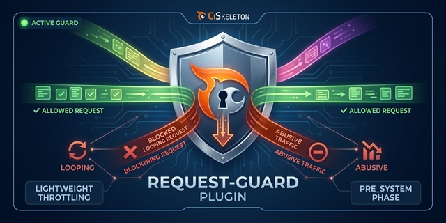

# CiSkeleton Plugin — Request Guard

Lightweight per-request limiter that prevents excessive bootstrapping or malicious request flooding during the `pre_system` phase.

  

## Info

This plugin provides lightweight in-process request throttling during the `pre_system` phase to mitigate excessive or looping requests.

The mechanism uses a static counter scoped to the current PHP process. Once the defined limit is reached, further requests are blocked with an HTTP 429 (Too Many Requests) response.

## Use Cases

* Preventing request floods caused by misconfigured clients.
* Throttling self-referential cron jobs or API calls.
* Guarding against runaway AJAX polling or error loops.

## Configuration

Define `CI_REQUEST_LIMIT` in your environment or config file to override the default limit (**20** requests per process).

## Limitations

* Applies only to the current PHP process; not global rate limiting.
* Reset on process restart (i.e., per-request on most PHP setups)

## License

MIT License. See [LICENSE](LICENSE.md) for details.

---

  <a href="https://github.com/ciskeleton">CiSkeleton</a> is created, developed, and maintained by <a href="https://github.com/bkader">Kader Bouyakoub</a>, trading as <a href="https://github.com/ianhubnet">Ianhub</a>.

